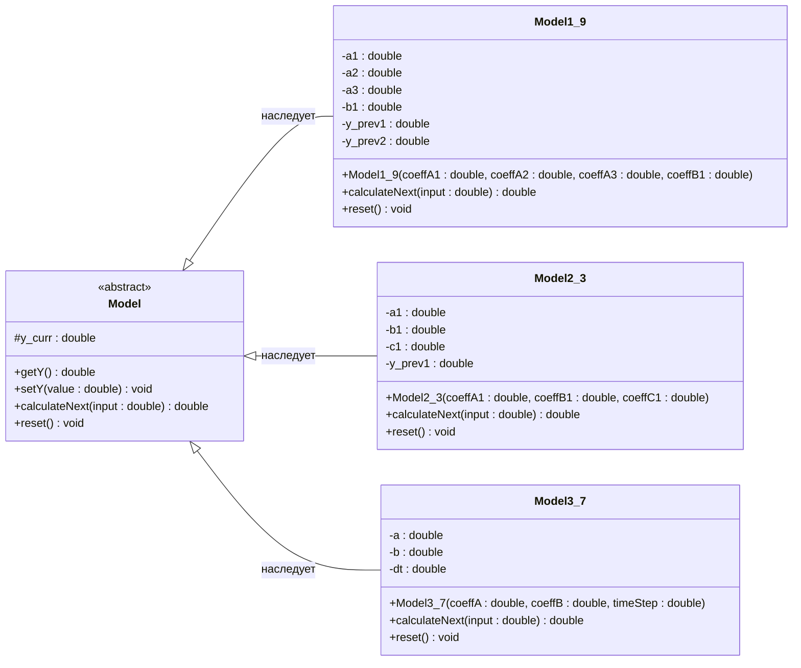

 Министерство образования Республики Беларусь

Учреждение образования

“Брестский Государственный технический университет”

Кафедра ИИТ

       

Лабораторная работа №1

По дисциплине “теория и методы автоматического управления”

Тема: “Моделирование контролируемых объектов”

     

Выполнил:

Студент 3 курса

Группы АС-67

Кошелев Б.В.

Проверил:

Дворанинович Д. А.

     

Брест 2026

 
 
 
 
## Вариант 19
 
## Математические уравнения моделей (Вариант 19)
1. **Линейная модель (Model 1.9):**
   $$Y_{\tau+1} = a_1 Y_{\tau} + a_2 Y_{\tau-1} + a_3 Y_{\tau-2} + b_1 u_{\tau}$$
2. **Нелинейная модель (Model 2.3):**
   $$Y_{\tau+1} = a_1 Y_{\tau} - b_1 Y_{\tau-1}^2 + c_1 u_{\tau}$$
3. **Дифференциальное уравнение (Model 3.7):**
   $$\frac{dy}{dt} = -e^a y + b u$$
   Численное решение методом Эйлера: $y_{t+1} = y_t + \Delta t \cdot (-e^a y_t + b u_t)$

 
## Архитектура классов (UML-диаграмма)
Ниже представлена интерактивная UML-диаграмма классов разработанного программного комплекса:

## Результаты моделирования и визуализация
Программа успешно выполняет симуляцию всех трех моделей для трех типов входных воздействий (ступенчатое, импульсное, гармоническое) и экспортирует результаты в `.csv` файлы.

### Графики переходных процессов (Python/Matplotlib)
На основе сгенерированных табличных данных с помощью библиотеки Matplotlib построены графики процессов симуляции контролируемых объектов:

